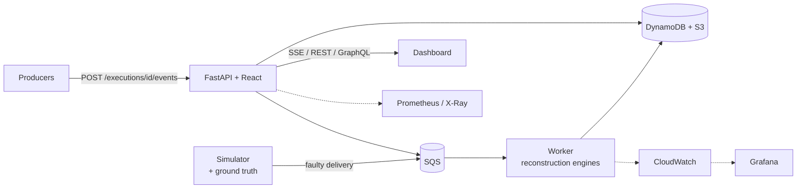

# ChronosMesh
> **Distributed Causality Reconstruction and Temporal Anomaly Detection for Multi-Cloud Microservices**

[](https://github.com/Akshith1413/ChronosMesh)
[]()
[]()
[]()
[]()
[]()

---

## 1. Problem statement

Microservices span regions and clouds. Network delay, retries, duplicate messages, partitions and clock drift make events reach
the monitoring sink in an order that has nothing to do with causality:

```text
Arrival order at the sink                          True causal order (happens-before)
  1. ORDER_CREATED     (Mumbai)                            ORDER_CREATED
  2. PAYMENT_COMPLETED (Singapore)                         /            \
  3. PAYMENT_STARTED   (Singapore)  <- late        PAYMENT_STARTED   INVENTORY_RESERVED   <- concurrent
  4. SHIPMENT_CREATED  (Singapore)                         |                |
  5. INVENTORY_RESERVED(GCP Mumbai) <- late        PAYMENT_COMPLETED         |
  6. NOTIFICATION_SENT (Mumbai)                            \            /
                                                       SHIPMENT_CREATED -> NOTIFICATION_SENT
```

Sorting by arrival time or by wall-clock timestamps produces phantom causal inversions. ChronosMesh reconstructs the **happens-before
DAG** from Lamport / vector / hybrid logical clocks plus verified parent links, proves which events were **concurrent**, and reports
what it *cannot* prove (lost events, unresolved parents, contradictory metadata) instead of guessing.

## 2. What is in the repository

| Capability | Where |
|---|---|
| **Clocks & causal rules** — Lamport, vector, hybrid logical clocks; happens-before; concurrency | `chronosmesh/clocks`, `chronosmesh/causality` |
| **Scalable reconstruction engine** — vector-clock covering edges (O(events × services)), verified declared parents, unresolved-parent tracking, idempotent ingest, lost-event bridging | `chronosmesh/reconstruction` |
| **11 anomaly types** — cycle, causal violation, clock drift, time inversion, duplicate, unresolved parent, orphan, vector-clock gap, concurrent mutation, retry storm, late arrival | `chronosmesh/analysis/anomaly.py` |
| **Fault-injection simulator with independent ground truth** — 2–50 services, up to 100 000 events, delay, heavy-tail latency, cross-region latency, clock drift, duplicates, loss, lost clock metadata, retry storms, worker crashes | `chronosmesh/simulator` |
| **Evaluation** — ChronosMesh vs arrival-order, wall-clock and declared-parents baselines: edge precision/recall/F1, event-ordering accuracy, late-edge recovery, concurrency classification, duplicate detection, recovery rate, latency/throughput/CPU/memory, 95 % CIs | `chronosmesh/evaluation`, [`docs/EVALUATION_RESULTS.md`](docs/EVALUATION_RESULTS.md) |
| **API** — JWT + 3-tier RBAC, owner-scoped experiments/executions, idempotent event ingest, SSE, GraphQL, Prometheus, OpenTelemetry | `api/` |
| **Queue worker** — SQS → engines → DynamoDB/S3, durable before ack, crash recovery, DLQ | `chronosmesh/worker`, `chronosmesh/transport`, `chronosmesh/persistence` |
| **Dashboard** — React 18 + TypeScript + Vite + D3: Trace Explorer, Timeline, Anomalies, What-If, **Experiment Lab**, **Observability** | `frontend/` |
| **Observability** — Prometheus metrics (blueprint names), Grafana dashboards A/B/C + AWS, alert rules, OTel collector | `observability/` |
| **AWS deployment** — ECS Fargate, SQS+DLQ, DynamoDB, S3, CloudFront, ALB, Secrets Manager, CloudWatch, X-Ray, EventBridge, SNS | `infrastructure/`, [`docs/CLOUD_DEPLOYMENT.md`](docs/CLOUD_DEPLOYMENT.md) |
| **CI/CD** — backend (3.11/3.12), frontend, Docker build + Trivy scan, IaC lint, evaluation reproduction, manual OIDC deploy | `.github/workflows/` |

### Architecture



## 3. Quick start

### A. Local, no cloud account (in-memory)
```bash
python -m venv venv && source venv/bin/activate
pip install -r requirements.txt -r api/requirements.txt && pip install -e .
cp .env.example .env                       # optional
python -m uvicorn api.main:app --port 8000 # UI + API at http://localhost:8000
```
Sign in with the local demo accounts `guru`/`chronosmesh` (admin), `analyst`/`analyst123`, `demo`/`demo123` — **local only**:
they are disabled when `ENVIRONMENT=production`.

### B. Full local stack in Docker (API + worker + local AWS emulator + Prometheus + Grafana + OpenTelemetry)
```bash
docker compose up --build            # UI http://localhost:8000 · Grafana http://localhost:3000 · Prometheus :9090
docker compose --profile full up     # + Kafka, Neo4j, Flink (optional streaming/graph stack)
```

### C. Frontend development
```bash
cd frontend && npm ci && npm run dev    # http://localhost:3000, proxied to the API on :8000
```

### D. Tests
```bash
python -m pytest tests -q               # 382 tests; AWS services are mocked with moto
cd frontend && npm test && npm run build
python examples/run_evaluation.py       # reproduce docs/EVALUATION_RESULTS.md (~11 min; --quick for a smoke run)
```

## 4. Using it

**Experiment Lab** (UI) — pick a scenario (out-of-order only, multi-cloud chaos, lossy metadata, retry storm, worker crashes, scale-out) or
dial the parameters, run it, and read the comparison against ground truth, the fault-tolerance report, the anomaly lab and a drill-down graph.

**API**
```bash
TOKEN=$(curl -s -d 'username=analyst&password=analyst123' localhost:8000/auth/login | jq -r .access_token)
H="Authorization: Bearer $TOKEN"

# run an experiment
ID=$(curl -s -H "$H" -H 'Content-Type: application/json' localhost:8000/api/experiments \
     -d '{"num_services":10,"num_events":5000,"network_delay_ms":500,"duplicate_rate":0.05,"missing_rate":0.02}' | jq -r .execution_id)
curl -s -X POST -H "$H" localhost:8000/api/experiments/$ID/start
curl -s -H "$H" localhost:8000/api/experiments/$ID/result | jq .summary.approaches.chronosmesh.f1

# ingest your own events (idempotent)
EX=$(curl -s -X POST -H "$H" -H 'Content-Type: application/json' localhost:8000/api/executions -d '{"name":"orders"}' | jq -r .execution_id)
curl -s -H "$H" -H 'Content-Type: application/json' localhost:8000/api/executions/$EX/events -d @examples/events.json
curl -s -H "$H" localhost:8000/api/executions/$EX/graph | jq '.edges, .unresolved'
```
Full contract: [`docs/API_CONTRACT.md`](docs/API_CONTRACT.md) · event schema and the formal causal rules: [`docs/EVENT_SCHEMA.md`](docs/EVENT_SCHEMA.md).

## 5. Results (reproducible, with ground truth)

From [`docs/EVALUATION_RESULTS.md`](docs/EVALUATION_RESULTS.md) (5 000 events, 10 services, 5 repeats, mean ± 95 % CI). Every number is produced by
`examples/run_evaluation.py`; read the caveats in that file (notably: with intact vector clocks ChronosMesh is exact by construction, and
at 30 % lost clock metadata its advantage over declared parents disappears).

**Out-of-order + ±200 ms clock drift**

| Approach | Edge F1 | Event-ordering accuracy | Concurrent recall |
|---|---|---|---|
| Arrival order | 0.058 ± 0.007 | 0.555 ± 0.005 | 0.000 ± 0.000 |
| Wall clock | 0.234 ± 0.016 | 0.627 ± 0.010 | 0.000 ± 0.000 |
| Declared parents | 0.862 ± 0.003 | 0.763 ± 0.009 | 1.000 ± 0.000 |
| **ChronosMesh** | 1.000 ± 0.000 | 1.000 ± 0.000 | 1.000 ± 0.000 |

**Everything at once (delay, drift, 10 % duplicates, 5 % loss)**

| Approach | Edge F1 | Event-ordering accuracy | Concurrent recall |
|---|---|---|---|
| Arrival order | 0.058 ± 0.004 | 0.519 ± 0.010 | 0.000 ± 0.000 |
| Wall clock | 0.238 ± 0.016 | 0.631 ± 0.010 | 0.000 ± 0.000 |
| Declared parents | 0.841 ± 0.004 | 0.690 ± 0.010 | 1.000 ± 0.000 |
| **ChronosMesh** | 1.000 ± 0.000 | 1.000 ± 0.000 | 1.000 ± 0.000 |

**30 % of events lose their vector clock**

| Approach | Edge F1 | Event-ordering accuracy | Concurrent recall |
|---|---|---|---|
| Arrival order | 0.057 ± 0.004 | 0.561 ± 0.007 | 0.000 ± 0.000 |
| Wall clock | 0.474 ± 0.003 | 0.997 ± 0.001 | 0.000 ± 0.000 |
| Declared parents | 0.837 ± 0.004 | 0.770 ± 0.009 | 1.000 ± 0.000 |
| **ChronosMesh** | 0.836 ± 0.004 | 0.934 ± 0.004 | 1.000 ± 0.000 |


## 6. AWS deployment

Two CloudFormation stacks (data, application) deployed with `infrastructure/scripts/deploy.sh`: CloudFront + private S3 front end, ALB that only
serves CloudFront, ECS Fargate (API, SQS worker, Grafana), DynamoDB, S3, SQS with a dead-letter queue, Secrets Manager, least-privilege IAM,
CloudWatch alarms/dashboard, X-Ray, EventBridge and SNS. Architecture, cost, runbook and the list of blueprint items **not** deployed (and why):
[`docs/CLOUD_DEPLOYMENT.md`](docs/CLOUD_DEPLOYMENT.md). Operations: [`docs/DISASTER_RECOVERY.md`](docs/DISASTER_RECOVERY.md), [`docs/OBSERVABILITY.md`](docs/OBSERVABILITY.md).

## 7. Security summary

JWT (HS256) with a mandatory strong secret in production, three roles, owner-scoped data, explicit CORS allow-list, authenticated SSE/GraphQL/metrics,
secrets only in Secrets Manager, non-root read-only containers, private buckets, ALB reachable only from CloudFront. Details and known limitations:
[`docs/SECURITY_MODEL.md`](docs/SECURITY_MODEL.md).

## 8. Documentation index

| Document | Description |
|---|---|
| [`docs/PROJECT_GUIDE.md`](docs/PROJECT_GUIDE.md) | **Start here:** the whole project explained from scratch — problem, theory, every module, how all AWS services connect, security, testing, operations, viva Q&A |
| [`docs/GAP_ANALYSIS.md`](docs/GAP_ANALYSIS.md) | **Baseline audit** (2026-10-12): everything missing/partial/broken, in the code and in AWS |
| [`docs/COMPLETION_STATUS.md`](docs/COMPLETION_STATUS.md) | **The same list updated** with what was completed, verification evidence and what remains |
| [`docs/EVALUATION_RESULTS.md`](docs/EVALUATION_RESULTS.md) | Research evaluation (generated) |
| [`docs/CLOUD_DEPLOYMENT.md`](docs/CLOUD_DEPLOYMENT.md) | What is deployed on AWS, cost, runbook |
| [`docs/API_CONTRACT.md`](docs/API_CONTRACT.md), [`docs/EVENT_SCHEMA.md`](docs/EVENT_SCHEMA.md) | API and event contracts, causal rules |
| [`docs/SECURITY_MODEL.md`](docs/SECURITY_MODEL.md), [`docs/OBSERVABILITY.md`](docs/OBSERVABILITY.md), [`docs/DISASTER_RECOVERY.md`](docs/DISASTER_RECOVERY.md) | Operations |
| [`docs/architecture.md`](docs/architecture.md), [`docs/VIVA_QA.md`](docs/VIVA_QA.md), [`docs/FINAL_DEMO_SCRIPT.md`](docs/FINAL_DEMO_SCRIPT.md), … | Original project documentation (some stage reports predate the 2026-10-12 work; see the status files above for current facts) |

## 9. Team

- **B. Guru Sai Prasad Reddy** — full-stack integration, FastAPI, React dashboard, security hardening, observability, DevOps.
- **Akshith** — clock algorithms, causal reconstruction, anomaly detection, root cause, what-if.
- **Surya** — ingestion design, schemas, multi-region mock cluster, storage layer design, chaos suite, Kubernetes manifests.

---

# Appendix — preserved from the original README

## A. Evaluation Rubric & Evidence Matrix (20 Marks, self-assessed by the team)

| S.No. | Evaluation Criteria | Marks | What Evaluated | Implementation & Forensic Evidence | Status |
| :---: | :--- | :---: | :--- | :--- | :---: |
| **1** | **Project Objective & Requirements** | **2** | Clear problem statement, objectives, requirements, and relevance | Multi-region causal reconstruction, out-of-order event handling, Lamport/Vector/HLC clocks ([`chronosmesh/clocks/`](chronosmesh/clocks/), [`docs/STAGE1_TO_API_MAPPING.md`](docs/STAGE1_TO_API_MAPPING.md)). | **COMPLETE** (2/2) |
| **2** | **System Architecture & Design** | **4** | Tech selection, architectural design, scalability, and reliability | Microservices $\to$ Kafka $\to$ Flink event-time pipeline $\to$ Neo4j $\to$ FastAPI $\to$ SSE $\to$ React 18 + D3 ([`docker-compose.yml`](docker-compose.yml), [`docs/architecture.md`](docs/architecture.md)). | **COMPLETE** (4/4) |
| **3** | **Implementation & Functionality** | **4** | Working application, integration of services, execution of major features | Partial order causality, $O(k \cdot \|V\|)$ incremental transitive reduction, anomaly detection, root-cause analysis, what-if replay ([`chronosmesh/causality/`](chronosmesh/causality/), [`chronosmesh/analysis/`](chronosmesh/analysis/)). | **COMPLETE** (4/4) |
| **4** | **Security & Access Control** | **2** | Authentication, authorization, access control, data protection | JWT auth (HS256) with a mandatory strong secret in production, 3-tier RBAC (`admin`, `analyst`, `viewer`), owner-scoped executions, explicit CORS allow-list, authenticated SSE/GraphQL/metrics, automatic log credential masking ([`api/auth.py`](api/auth.py), [`docs/SECURITY_MODEL.md`](docs/SECURITY_MODEL.md)). | **COMPLETE** (2/2) |
| **5** | **Database & Data Management** | **2** | Database selection, data organization, CRUD operations, management | Neo4j property graph persistence with Cypher traversals and in-memory fallback, time-series arrival audit, schema indexes ([`chronosmesh/storage/neo4j_store.py`](chronosmesh/storage/neo4j_store.py), [`docs/NEO4J_SCHEMA.md`](docs/NEO4J_SCHEMA.md)). | **COMPLETE** (2/2) |
| **6** | **Deployment & DevOps** | **2** | Deployment process, CI/CD automation, config management, reproducibility | Multi-stage Docker images + Compose, **CloudFormation stacks deployed to AWS** ([`infrastructure/`](infrastructure/)), Kubernetes manifests ([`k8s/`](k8s/)), GitHub Actions CI/CD ([`.github/workflows/`](.github/workflows/)), one-click startup ([`start_guru.bat`](start_guru.bat)). | **COMPLETE** (2/2) |
| **7** | **Monitoring, Performance & Optimization** | **1** | Monitoring, logging, performance analysis, and optimization | Prometheus `/metrics` exporter with the blueprint metric names, Grafana dashboards A/B/C + AWS, alert rules, CloudWatch alarms ([`observability/`](observability/)), measured throughput in [`docs/EVALUATION_RESULTS.md`](docs/EVALUATION_RESULTS.md). | **COMPLETE** (1/1) |
| **8** | **Documentation & Presentation** | **2** | Architecture diagrams, documentation, screenshots, demonstration scripts | Documentation in [`docs/`](docs/), presentation deck ([`docs/PRESENTATION_DECK.md`](docs/PRESENTATION_DECK.md)), demo scripts, viva prep ([`docs/VIVA_QA.md`](docs/VIVA_QA.md)). | **COMPLETE** (2/2) |
| **9** | **Innovation & Problem Solving** | **1** | Creativity, technical challenges, problem-solving approach | TrueTime confidence scoring ($P(A \to B)$), out-of-order tumbling buffer, localized DAG pruning, forward what-if fault blast radius simulation. | **COMPLETE** (1/1) |
| **—** | **TOTAL** | **20** | **Comprehensive Academic & Technical Verification** | **382 Python tests + 29 Vitest tests passing + clean Vite production build** | **20 / 20** |

---

## B. Deterministic Demo Sequence (`TRACE-DEMO-001`)

1. Open `http://localhost:8000` (or `http://localhost:3000` in dev mode) in your browser.
2. Sign in with the local demo accounts (shown only when the server has demo users enabled — i.e. local runs, not the AWS deployment):
   - **Admin:** `guru` / `chronosmesh` (Full configuration, scenario triggering, and resets)
   - **Analyst/Operator:** `analyst` / `analyst123` (Analysis, what-if, benchmarks)
   - **Viewer:** `demo` / `demo123` (Read-only view)
   - *Note:* Intuitive **`Log In`** and **`Log Out`** controls are always available in both the top-right Navbar and bottom-left Sidebar user card.
3. Under **Scenarios**, select **Deterministic E-Commerce Order Flow (`TRACE-DEMO-001`)** (or click the **⚡ Load TRACE-DEMO-001** button on the overview).
4. Observe the dynamic results:
   - **Reconstructed Causal DAG:** ChronosMesh mathematically reorders events and automatically selects the initial root event (`ORDER_CREATED`), immediately populating the **Event Details** inspection drawer.
   - **Interactive Node Inspection:** Click or tap any node in the DAG (`PS`, `PC`, `IR`, `SC`, `NS`) to inspect its exact causality metadata, logical clock, and parent/child dependencies with responsive hitboxes on all devices.
   - **Raw Arrival Order:** View side-by-side comparison of disordered arrival order vs true causal order.
   - **Deterministic Service Health Map:** Real-time operational status per service (Healthy, Degraded, Critical).
   - **Anomalies Panel:** Inspect cross-region clock drift, physical clock inversions, and TrueTime confidence scores.
   - **What-If Simulation:** Invalidate an event to calculate downstream cascade blast radius and graph diffs.

---

## C. Dashboard guide: design system and views

ChronosMesh provides a production-grade distributed systems observability dashboard and analysis engine:

### C.1 "Chrono Pearl" Design System (`frontend/src/styles/`)
A light, glassy, iridescent theme — frosted-glass panels over a drifting pastel aurora, ink-navy type, and an iris gradient (violet → azure → mint).
- **Tokens (`tokens.css`):** ink/paper/glass colour scales, semantic status colours, per-service hues, tinted elevation, and motion curves (`--ease-out`, `--ease-spring`). The old `--cm-*` variables remain as aliases.
- **Type:** Instrument Serif (display & numerals), Instrument Sans (UI), JetBrains Mono (data).
- **Primitives (`components.css`):** `.panel`, `.btn`, `.chip`, `.kpi`, `.seg` (sliding-thumb tabs), `.field`/`.input`/`.range`, `.loader`, `.empty`, `.errorbox`.
- **Interaction layer (`src/fx/`):** pointer-driven 3D tilt + spotlight borders, magnetic buttons, count-up numbers, scroll reveals, click ripples — all via CSS variables, no re-renders. Every effect honours `prefers-reduced-motion`.
- **3D without a dependency (`src/fx/engine3d.ts`):** a small perspective-projection canvas engine (depth fog, lit "pearl" spheres, bezier threads with travelling pulses) powering the landing hero, the service orbit and the 3D causal graph.

### C.1.1 Signature interactions
- **Landing hero — the order lens:** events float scrambled in 3D; sweep the clock-bezel lens (or drag the *Reconstruction* slider) and they snap into their causal DAG with swimlanes and a Lamport axis.
- **Log shuffler** (arrival → causal re-sort), and a **vector-clock playground**: build a distributed execution, hover any event to see *happened-before / after / concurrent*.
- **Dock navigation** with a liquid highlight, and a **⌘/Ctrl + K command palette** to jump between views or load a trace.
- **Causal graph:** 2D swimlane view (hover isolates an event's causal lineage) or a rotatable **3D slab view**; blast-radius simulations cascade through the graph in causal order.
- **Timeline braid:** threads connect where each event *arrived* to where it *happened*; replay with play / step / speed controls.

### C.2 Five Advanced Analysis APIs (`api/routers/analysis_router.py` & `api/services/analysis_service.py`)

| Method | Endpoint | Description | Return Model |
|---|---|---|---|
| `GET` | `/api/analysis/service-health` | Deterministically derived service health (`Healthy`, `Degraded`, `Critical`, `Unavailable`) based on active DAG events and detected anomalies. | `ServiceHealthReport` |
| `GET` | `/api/analysis/clock-drift-timeline` | Physical clock skew and arrival delay per event across causal edges. **Zero subtraction of Lamport integers from physical milliseconds.** | `ClockDriftTimeline` |
| `GET` | `/api/analysis/latency-histogram` | Distribution of positive edge transit times with exact percentiles (`p50`, `p95`, `p99`, `min`, `max`, `mean`). Isolates negative time-inversion edges. | `LatencyHistogramReport` |
| `GET` | `/api/analysis/topology-stats` | NetworkX graph-theoretic analysis: node/edge count, density, longest causal path, coupling metric ($2E/V$), and pairwise concurrency factor. | `TopologyStatsReport` |
| `GET` | `/api/analysis/event-replay` | Topological generation layers reconstructing execution sequences where concurrent events execute in parallel without fake serialization. | `EventReplayReport` |

### C.3 UI Views & Capabilities
1. **System Overview Dashboard:** Real API metrics, dynamic Service Health Map, live causal edge transit latencies, recent anomaly alerts, and a prominent 1-click **⚡ Load TRACE-DEMO-001** trigger.
2. **Trace Explorer & Causal Graph:** 2D (D3) swimlanes and a rotatable 3D view, zoom/pan/fit toolbar, lineage-isolating hover, anomaly/root-cause highlights, and a rich event inspector (Event ID, type, service, Lamport, vector clock, physical time, clickable parents/children) with initial root auto-selection. The active trace is rehydrated from the API after a page reload.
3. **Timeline Replay:** a braid view comparing **Kafka Arrival Order** (disordered) with **Reconstructed Causal Order** (topologically verified), with threads showing each event's displacement.
4. **Anomaly Center:** Categorized triage (Critical, Warning, Info), search filter, and diagnosis drawer.
5. **Root-Cause Analysis:** Structured diagnosis flow (`ROOT CAUSE` → `CAUSAL CHAIN` → `AFFECTED SERVICES` → `DOWNSTREAM IMPACT`).
6. **What-If Blast Radius Lab:** Counterfactual non-destructive simulation (`🧪 SIMULATION MODE`) calculating cascade depth and affected nodes/services upon event removal.
7. **Analytics Page:** Multi-tab technical dashboard featuring edge latency histograms, graph topology metrics, and step-through causal layer replay.
8. **Graph Diff View:** Structural comparison against the baseline topology — a verdict banner plus added/removed nodes and edges, computed from the API's real diff.
9. **Authentication & Session Controls:** user card in the dock with `Log Out` / `Log In`, session-expiry detection, and 1-click demo logins in the sign-in modal.

---

## D. Earlier micro-benchmarks (pre-2026-10-12, in-process)

> Measured before the reconstruction engine and evaluation harness were added; see `docs/EVALUATION_RESULTS.md` for the current, ground-truth-scored results.

| Metric | Measured Value | Benchmark Scope & Measurement Boundary |
| :--- | :--- | :--- |
| **Generation Rate** | **3,602.3 events/sec** | In-memory synthetic event generation (`load_test.py`) |
| **Stream Processing Rate** | **211.7 events/sec** | Event-time windowed pipeline with out-of-order buffering |
| **Persistence Rate** | **4,044.5 events/sec** | In-memory property graph node/edge batch ingestion |
| **Generation Latency (p50)**| **0.518 ms** | In-memory event creation & enqueue median latency |
| **Pipeline Latency (p95)**| **35.349 ms** | End-to-end stream window flush interval |
| **Pipeline Latency (p99)**| **62.222 ms** | Tail latency under burst queueing |
| **Causal Reduction Speedup**| **3.1x faster** (at 1,000 ev)| Localized incremental pruning (288.58ms) vs global (890.22ms) |
| **Event Loss / Duplicates**| **0 / 0** | Zero dropped events; idempotent graph writes |

---
