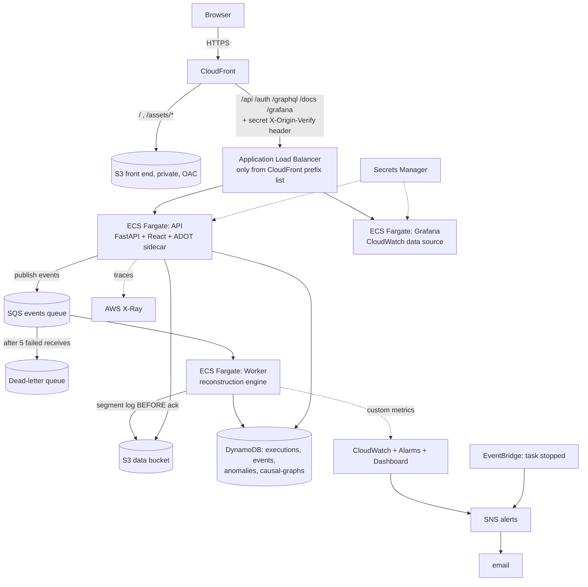

# ChronosMesh — Cloud Deployment (AWS)

This document describes what is **actually deployed** by `infrastructure/` and how to operate it. The earlier version of
this file was a blueprint for MSK/EKS/Aura that had never been executed; those parts are listed under
[Not deployed, and why](#not-deployed-and-why).

Region `ap-south-2` (Hyderabad) · IaC: AWS CloudFormation · two stacks split by lifecycle.

## 1. Architecture



Data flow of an experiment with `transport: sqs`: the API simulates the workload and a fault-injected delivery stream,
keeps the ground truth in S3, publishes the stream to SQS, the worker reconstructs the graphs (writing every message to the
S3 segment log before acknowledging it) and scores them against the ground truth, then marks the experiment `succeeded`.

## 2. Stacks and resources

### `chronosmesh-<env>-data` (long-lived — `infrastructure/cloudformation/data.yaml`)

| Resource | Configuration |
|---|---|
| DynamoDB ×4 (`executions`, `events`, `anomalies`, `causal-graphs`) | On-demand, **TTL** (`expires_at`), **point-in-time recovery**, SSE; GSIs `owner-created-index` (executions) and `service-time-index` (events) |
| S3 data bucket | Private, versioned, SSE-S3, TLS-only policy, lifecycle (30 days for `executions/`, 7 days for old versions) |
| SQS events queue + DLQ | SSE-SQS, long polling, 120 s visibility timeout, **redrive after 5 receives** to a 14-day DLQ, TLS-only |
| SNS alerts topic | Policy allows CloudWatch, Budgets and EventBridge; email subscription (confirm the link AWS sends) |
| Secrets Manager ×7 | Generated JWT key, metrics token, `admin`/`analyst`/`viewer`/Grafana passwords, CloudFront↔ALB shared secret |
| ECR ×3 | `chronosmesh-<env>/{api,worker,grafana}`: immutable tags, scan-on-push, keep last 10 |

The monthly **budget** (default $100; alerts at 80 % actual and 100 % forecast to the SNS topic) is created by
`infrastructure/scripts/budget.sh` because `AWS::Budgets::Budget` is not available in this region's CloudFormation.

### `chronosmesh-<env>-app` (replaceable — `infrastructure/cloudformation/app.yaml`)

| Resource | Configuration |
|---|---|
| ECS cluster + 3 Fargate services | **API** (512 CPU / 2 GB, autoscaling 1–3 on CPU 60 %, ADOT tracing sidecar), **Worker** (256 / 1 GB, exactly one consumer), **Grafana** (256 / 512 MB, stateless, provisioned). Deployment circuit breaker with automatic rollback; tasks run non-root with a read-only root filesystem |
| ALB | Internet-facing but its security group admits **only CloudFront's origin-facing prefix list**, and listener rules require the secret `X-Origin-Verify` header; default action is 403. Cookie stickiness for the API (explorer state is per replica) |
| CloudFront + S3 | React build in a private bucket via **Origin Access Control**; `/api/*`, `/auth/*`, `/graphql*`, `/docs*`, `/redoc*`, `/openapi.json`, `/grafana/*` go to the ALB uncached; HTTPS redirect; managed security-headers policy; HTTP/2+3 |
| IAM | Execution role (ECR/logs + the six secrets) and **one task role per workload**, scoped to named tables/indexes, `executions/*` objects, the one queue; `PutMetricData` limited to the `ChronosMesh` namespace |
| CloudWatch | 8 alarms (API unhealthy targets / 5xx / CPU, **worker heartbeat missing**, queue backlog age, **DLQ not empty**, processing errors, unresolved dependencies), a dashboard, log groups with 30-day retention |
| EventBridge | Rule: ECS task stopped with `TaskFailedToStart`/`EssentialContainerExited` → SNS |

## 3. Deploy, operate, destroy

Prerequisites: AWS CLI v2-compatible credentials with permission to create the above, Docker, `curl`.

```bash
# first deployment or any update (idempotent): builds + pushes images, deploys both stacks, publishes the front end
ALERT_EMAIL=you@example.com BUDGET_USD=100 ./infrastructure/scripts/deploy.sh

./infrastructure/scripts/credentials.sh --show   # sign-in passwords for admin / analyst / viewer (generated, never in Git)
./infrastructure/scripts/scale.sh down           # stop all compute when not demoing (ALB/CloudFront still bill a little)
./infrastructure/scripts/scale.sh up             # bring it back (~2 min)
./infrastructure/scripts/destroy.sh              # remove the application stack, keep the data
./infrastructure/scripts/destroy.sh --include-data
```

`SKIP_BUILD=1 IMAGE_TAG=<tag>` redeploys images that are already in ECR. CI: `.github/workflows/deploy.yml` (manual) does the
same through GitHub OIDC without long-lived keys once the role in `infrastructure/cloudformation/github-oidc.yaml` exists.

### Smoke test (what `deploy.sh` runs)
`GET /api/health`, `GET /api/health/ready` (checks DynamoDB + S3), and the front end through CloudFront. Then log in as
`analyst` and run an experiment with `transport: sqs` from the **Experiment Lab** to exercise API → SQS → worker → DynamoDB/S3.

### Acceptance test
`python infrastructure/scripts/verify_deployment.py` runs 50 checks against the live environment (security edge, an in-process experiment, an
experiment through SQS and the worker, live ingest, authorisation, DynamoDB/S3/CloudWatch/X-Ray/SNS/ECS state, Grafana). It last passed 50/50 on
2026-10-13 against `https://d3aaa3amvwsyjx.cloudfront.net`.

## 4. Cost (rough, ap-south-2, running 24×7)

| Item | ≈ USD / month |
|---|---|
| Fargate API (0.5 vCPU / 2 GB) | 24 |
| Fargate worker (0.25 vCPU / 1 GB) | 11 |
| Fargate Grafana (0.25 vCPU / 0.5 GB) | 9 |
| Application Load Balancer + public IPv4 addresses (ALB ×2–3, tasks ×3) | 28–32 |
| CloudFront, S3, DynamoDB (on-demand), SQS, SNS, Secrets (7 × $0.40), CloudWatch alarms/dashboard | 8–15 |
| **Total** | **≈ 80–90** |

`scale.sh down` removes the Fargate share (~$44) and the task IPv4 charges; set a lower `MonthlyBudgetUsd`/`BUDGET_USD` to be warned earlier.
Public IPv4 addresses are billed hourly since 2024; a NAT gateway (≈ $35+/month) was deliberately **not** used.

## 5. Not deployed, and why

| Blueprint item | Status |
|---|---|
| **Amazon MSK / Kinesis / Managed Flink** | **Blocked by the account**: the API returns `SubscriptionRequiredException` (free-tier restriction). SQS is the transport; Kafka/Flink code paths exist and run locally (`docker compose --profile full`). Moving to MSK needs a paid plan and a `KafkaTransport` beside `SqsTransport`. |
| API Gateway + Cognito | The API authenticates with its own JWT/RBAC behind CloudFront; adding API Gateway would duplicate the CloudFront/ALB path without a new capability. |
| AWS WAF | Cost (~$6+/month); recommended before exposing the site to untrusted traffic (managed rule groups on the CloudFront distribution). |
| Step Functions | Experiments are bounded single jobs; there is no multi-step workflow to orchestrate. |
| EKS, ElastiCache, RDS, Managed Prometheus/Grafana | Optional/advanced in the blueprint; `k8s/` manifests are provided but not applied. Grafana runs as a Fargate task against CloudWatch; Prometheus runs locally in `docker compose`. |
| Custom domain + ACM | Needs a domain you own; until then CloudFront ↔ ALB is HTTP (restricted by prefix list + secret header). |
| Multi-region / GCP | Single region; the multi-cloud aspect is simulated by the workload generator (AWS/GCP region labels and per-service clock skew). |

## 6. Legacy resources from the original hand-built deployment

These pre-date the IaC and are **not managed by it**; they are left untouched so nothing you rely on breaks. Recommended clean-up
once you have verified the new stack:

* EC2 `ChronosMesh-Server` (t3.small, `18.61.252.175`) running the old API over HTTP with the default demo credentials, and a second
  EC2 (t3.micro) that answers on no port — both cost money and the first is publicly open.
* Security group `chronosmesh-sg` allows **all traffic from 0.0.0.0/0** (plus SSH, 3000, 9090) and `launch-wizard-1` exposes 22/8000.
* IAM roles `chronosmesh-ecs-task-role` (SQS/DynamoDB/S3/CloudWatch *FullAccess*) and `chronosmesh-ecs-execution-role`.
* Empty hand-made tables/queues/buckets/repos named `chronosmesh-*` (no `-prod-`), the empty ECS cluster `chronosmesh-cluster`,
  task definition `chronosmesh-api:1`, and the user-data script `infrastructure/userdata.sh` (superseded by `deploy.sh`).
