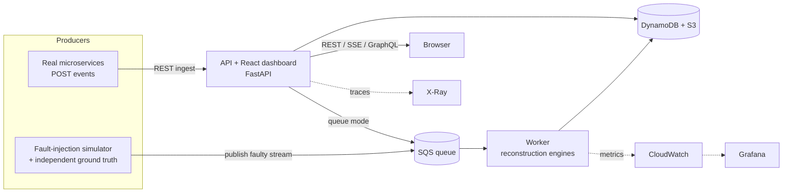
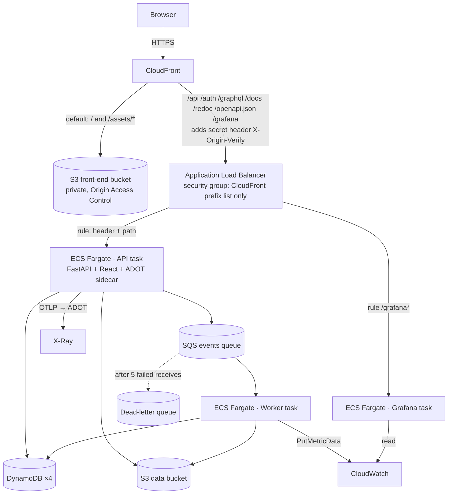

# ChronosMesh — The Complete Project Guide

*A from-scratch explanation: the problem, the ideas, the code, how every service is connected, and how to run, test, deploy and defend it.*

> **How to read this.** Part 1–2 explain *why the project exists* and the theory (no code knowledge needed). Part 3 is the big
> picture. Parts 4–6 follow the code and the data. Part 7 is every AWS service and how they connect. Parts 8–12 cover security,
> observability, testing, running, and decisions. Part 13 is a viva-style Q&A. File paths are relative to the repository root.

## Contents
1. [The problem](#1-the-problem)
2. [The core ideas](#2-the-core-ideas)
3. [The big picture](#3-the-big-picture)
4. [The code, module by module](#4-the-code-module-by-module)
5. [How data flows end to end](#5-how-data-flows-end-to-end)
6. [The frontend](#6-the-frontend)
7. [AWS: every service and how it is connected](#7-aws-every-service-and-how-it-is-connected)
8. [Security design](#8-security-design)
9. [Observability](#9-observability)
10. [Testing and CI/CD](#10-testing-and-cicd)
11. [Running, deploying and operating it](#11-running-deploying-and-operating-it)
12. [Design decisions and trade-offs](#12-design-decisions-and-trade-offs)
13. [Viva-style questions and answers](#13-viva-style-questions-and-answers)
14. [Limitations and future work](#14-limitations-and-future-work)
15. [Glossary](#15-glossary)
16. [Appendix: repository map](#16-appendix-repository-map)

---

## 1. The problem

Modern applications are split into **microservices** that run on different machines, often in different cloud regions. When a
customer places an order, several services take part:

```text
Order Service ──► Payment Service ──► Bank
      │
      └────────► Inventory Service ──► Shipping Service
```

Each service writes **events** ("order created", "payment started", "stock reserved", …) to a central place so engineers can see what
happened. The trouble: the order in which events *arrive* at that central place is not the order in which things *happened*.

Why events arrive in the wrong order:

| Cause | What happens |
|---|---|
| Network latency differs per region | A Singapore event can arrive after a Mumbai event that happened later |
| Message brokers / retries | A message is retried and arrives late, or arrives twice |
| Different clocks | Every machine has its own clock; they drift by milliseconds to seconds |
| Lost messages | Some events never arrive at all |

Example. The true story:

```text
E1 ORDER_CREATED ──► E2 PAYMENT_STARTED ──► E4 PAYMENT_COMPLETED ──┐
        └─────────► E3 STOCK_CHECKED   ──► E5 STOCK_RESERVED    ───┴─► E6 SHIPPING_CREATED
```

What the monitoring system receives, in arrival order: `E5, E4, E6, E1, E3, E2`. Sorting by arrival (or by each machine's timestamp)
shows "stock reserved" **before** "order created" — a timeline that never happened. That produces false alerts and wrong
debugging conclusions.

**ChronosMesh answers one question: "what actually caused what?"** It rebuilds the true cause-and-effect graph (a DAG) from the
events, proves which events were *concurrent* (neither caused the other), and honestly reports what it cannot prove (events that
were lost, parents that never arrived, metadata that contradicts itself).

This is a **cloud / distributed-systems** project (the problem only exists *because* services are distributed), not an AI project.

---

## 2. The core ideas

### 2.1 "Happened-before" (Leslie Lamport, 1978)
Write `A → B` ("A happened before B") when A could have influenced B. Two events with no such relation are **concurrent**, written
`A ∥ B`. Time of day is *not* part of the definition — only causality.

Rules: events on the same service are ordered by their sequence; a message send happens before its receive; and the relation is
transitive (`A → B` and `B → C` ⇒ `A → C`).

### 2.2 Logical clocks
Instead of trusting physical clocks, every event carries **logical clock** values that the services maintain themselves:

* **Lamport clock** — one integer per service. Increment on each local event; when receiving a message with timestamp `t`, set
  `local = max(local, t) + 1`. If `A → B` then `L(A) < L(B)`, **but the reverse is not true**, so Lamport clocks can order events yet
  cannot prove concurrency.
* **Vector clock** — one integer *per service*: `{order: 2, payment: 4, inventory: 1}`. Each service increments only its own
  entry; on receiving a message it takes the element-wise maximum. Then:
  * `A → B` ⇔ `V(A) ≤ V(B)` in every component and `V(A) ≠ V(B)`;
  * `A ∥ B` ⇔ neither vector is ≤ the other.
  
  Vector clocks **can prove concurrency**. This is the core of ChronosMesh.
* **Hybrid Logical Clock (HLC)** — a physical timestamp plus a logical counter; included in the project for comparison.

Worked example (from the project brief):

```text
Order created        O = [1,0,0]
Payment receives it  P = [1,1,0]  → payment starts P = [1,2,0]
Inventory (independent) I = [1,0,1]

Payment [1,2,0] vs Inventory [1,0,1]:
   P ≤ I ?  2 > 0 → no        I ≤ P ?  1 > 0 → no        ⇒  Payment ∥ Inventory  (concurrent)
```

### 2.3 The causal DAG
Each event is a node; a **direct cause** is an edge. We keep only *direct* edges (the **transitive reduction**): if
`A → B → C`, we do not also draw `A → C`. The graph must be acyclic — a cycle means the metadata is inconsistent, which is reported
as an anomaly rather than silently "fixed".

### 2.4 What ChronosMesh will and will not claim
* It never uses wall-clock time to *create* edges — only to *detect* problems (time inversions, clock drift).
* If a declared parent has not arrived, it records an **unresolved dependency** instead of inventing an edge; the edge appears
  automatically when the parent arrives.
* If an event was lost, a vector clock still proves the ordering across the gap; that edge is labelled `inferred / via_gap`.
* Duplicate deliveries are recognised by event id and ignored (**idempotent** processing).
* With **no vector clock** on an event (un-instrumented service), it falls back to the declared parent links and says so
  (`verified = false`). Lamport time alone can order but cannot prove concurrency.

---

## 3. The big picture

### 3.1 What the system does, in one diagram



### 3.2 The six layers

| Layer | Job | Where in the repo |
|---|---|---|
| **1. Event model** | One agreed event format with logical clocks and parent links | `chronosmesh/events/` |
| **2. Reconstruction engine** | Turn events into the causal DAG; detect anomalies | `chronosmesh/reconstruction/`, `chronosmesh/causality/`, `chronosmesh/analysis/` |
| **3. Simulator + evaluation** | Generate faulty executions with known truth and *measure* correctness | `chronosmesh/simulator/`, `chronosmesh/evaluation/` |
| **4. Transport + persistence + worker** | Move events reliably, store results, survive crashes | `chronosmesh/transport/`, `chronosmesh/persistence/`, `chronosmesh/worker/` |
| **5. API + UI** | Authenticate users, expose everything, visualise it | `api/`, `frontend/` |
| **6. Platform** | Containers, AWS infrastructure, monitoring, CI/CD | `infrastructure/`, `observability/`, `api/Dockerfile`, `.github/workflows/` |

### 3.3 Two ways to run it

* **Local / no cloud** — everything in memory (`uvicorn`), or the full Docker Compose stack with a local AWS emulator.
* **AWS** — the same code, switched by environment variables (`STORAGE_BACKEND`, queue URL, …) to use DynamoDB, S3 and SQS.

The same Python package runs in both. `chronosmesh/config.py` reads the environment; `chronosmesh/persistence/__init__.py`
(`create_repository`) picks the in-memory or the DynamoDB/S3 repository. That is how a laptop and a Fargate task run identical logic.

---

## 4. The code, module by module

### 4.1 Event model — `chronosmesh/events/event.py`
`Event` is a dataclass: `event_id`, `service_id`, `event_type`, `trace_id`, `span_id`, `parent_event_ids`, `lamport_ts`,
`vector_clock`, `hlc_ts`, `timestamp_ms` (when it happened at the producer, subject to skew), `arrival_time_ms` (when the platform
received it) and `execution_id` (one business flow; falls back to `trace_id`).

* `to_spec_dict()` / `from_spec_dict()` use the **published contract** names (`service`, `lamport_clock`, `event_time`,
  `ingestion_time`, ISO-8601 times). `from_dict()` accepts both naming styles, so old producers keep working.
* Formal rules and the field table: [`EVENT_SCHEMA.md`](EVENT_SCHEMA.md).

### 4.2 Clocks — `chronosmesh/clocks/`
`lamport.py`, `vector.py`, `hlc.py` implement the three clock types behind one interface (`base.py`); `factory.py` creates them by
name. They are the original Stage-1 algorithms and are covered by unit tests (`tests/unit/test_lamport.py`, `test_vector.py`,
`test_hlc.py`, `tests/correctness/test_clock_invariants.py`).

### 4.3 Causality — `chronosmesh/causality/`
* `happens_before.py` — compares two events (vector clocks first, Lamport as fallback) → `HAPPENS_BEFORE / AFTER / CONCURRENT / EQUAL`.
* `concurrency.py` — finds concurrent pairs and groups.
* `dag_builder.py` — the original NetworkX builder: pairwise comparison (O(n²)), incremental updates, **unresolved-parent
  tracking and retro-linking** (added), duplicate suppression.
* `transitive_reduction.py` — removes redundant edges (batch and incremental).
* `buffer.py` — a reorder buffer used by the Flink-style pipeline.

### 4.4 The scalable reconstruction engine — `chronosmesh/reconstruction/`
This is the core contribution.

**`fast.py` — the algorithm.** For an event `b` with vector clock `V_b`, its *direct* predecessors are the latest known event of each
service that `b` has seen. So it:
1. indexes events by `(service, own counter)`;
2. for each service `s`, finds (by binary search) the latest known event of `s` with counter ≤ `V_b[s]` — **one candidate per service**;
3. removes candidates that are themselves causes of another candidate (`x → y` ⇔ `V_y[service(x)] ≥ counter(x)`);
4. adds declared parent links **only if** they agree with the clocks (`V_parent ≤ V_child`); contradictions are rejected and reported;
5. records declared parents that were never seen as `unresolved`;
6. flags edges that bridge a lost event (`via_gap`), and breaks any cycle caused by bad metadata.

Cost: O(events × services) instead of O(events²). It is **proven equal** to an independent oracle (program order + declared edges →
NetworkX transitive reduction) on random workloads (`tests/unit/test_reconstruction.py`), and the test was mutation-checked
(deliberately breaking the algorithm makes it fail).

**`engine.py` — `ReconstructionEngine`** (one per execution). `ingest(event)` is O(1) and idempotent: it stores the event, counts a
duplicate if the id was seen, and tracks which declared parents are still missing. The graph is rebuilt **lazily** the first time it
is read after a change, so the result never depends on arrival order. It also provides `anomalies()`, `snapshot()` (the JSON the UI
draws), `stats()`, and `checkpoint()` / `restore()` (used for crash recovery).

### 4.5 Anomaly detection — `chronosmesh/analysis/anomaly.py`

| Type | Severity | Meaning |
|---|---|---|
| `CYCLE` | critical | The graph is not acyclic (inconsistent metadata) |
| `CAUSAL_VIOLATION` | critical | A declared parent is not covered by the child's clocks |
| `CLOCK_DRIFT` | critical | Two services' wall clocks provably disagree beyond tolerance |
| `TIME_INVERSION` | warning | A causal child carries an older wall-clock time than its parent |
| `DUPLICATE_EVENT` | warning | Same event id delivered more than once |
| `UNRESOLVED_PARENT` | warning | A declared parent has not been observed |
| `ORPHAN_EVENT` | warning | *All* declared parents are unresolved |
| `VECTOR_CLOCK_GAP` | warning | A service's own counter skips values (events lost) |
| `CONCURRENT_MUTATION` | warning | Two services wrote the same resource with no causal order |
| `RETRY_STORM` | warning/critical | Many retries of the same operation |
| `LATE_ARRIVAL` | info | A parent arrived after its causal child |

Other analyses kept from the original project: confidence scoring (`confidence.py`, TrueTime-style probabilities), root-cause tracing
(`root_cause.py`), what-if blast radius (`what_if.py`), clock benchmarking (`benchmarking.py`), graph diff (`graph_diff.py`).

### 4.6 The simulator — `chronosmesh/simulator/`
To *measure* correctness you need to know the right answer. The simulator generates the truth, then degrades what the platform sees.

* `workload.py` — creates many independent **executions** (business flows) across 2–50 services. Each event has *true* vector clocks,
  true times and declared parents (forks and joins). Optional **retry storms** are real events in the truth.
* `faults.py` — turns the truth into the **delivered** stream: random/heavy-tailed delay, cross-region latency, per-service clock
  drift on the wall-clock timestamp, duplicates, lost events, lost vector clocks (un-instrumented services). It never modifies the truth.
* `config.py` — `ExperimentConfig` with the allowed ranges (services 2–50, events up to 100 000, delay 0–2000 ms, duplicates ≤ 10 %,
  loss ≤ 5 %, repeats ≤ 30, …).

### 4.7 The evaluation — `chronosmesh/evaluation/`
`runner.py` runs *simulate → inject faults → reconstruct (streaming engines, with optional worker crashes) → score*. Four approaches
are compared against the truth:

1. **Arrival order** (chain of events in arrival order)
2. **Wall clock** (chain sorted by timestamp)
3. **Declared parents** (trusts `parent_event_ids`, no logical clocks — what trace-propagation tools give)
4. **ChronosMesh** (vector clocks + verified parents)

Metrics: edge precision / recall / F1, **event-ordering accuracy**, **late-edge recovery**, concurrency classification, duplicate
detection rate, recovery rate, reconstruction latency, throughput, CPU, peak memory, with 95 % confidence intervals over repeats.
Results and caveats: [`EVALUATION_RESULTS.md`](EVALUATION_RESULTS.md); reproduce with `python examples/run_evaluation.py`.

### 4.8 Persistence — `chronosmesh/persistence/`
One interface (`base.py`, `Repository`), two implementations:

* `memory.py` — thread-safe, in-process (tests, laptops).
* `aws.py` — **DynamoDB + S3** (`AwsRepository`).

| Store | Holds |
|---|---|
| DynamoDB `…-executions` | one item per experiment/execution: owner, status, progress, config, summary. GSI `owner-created-index` ("my executions, newest first") |
| DynamoDB `…-events` | raw events of small executions. GSI `service-time-index` |
| DynamoDB `…-anomalies` | one item per anomaly |
| DynamoDB `…-causal-graphs` | pointer + size summary of a graph |
| S3 `executions/<id>/graph.json` | the reconstructed graph |
| S3 `executions/<id>/result.json`, `ground_truth.json`, `truth.json`, `events.json` | experiment results, truth, drill-down data |
| S3 `executions/<id>/segments/<seq>.json.gz` | the **durable ingest log** (see 4.10) |

Every DynamoDB item has an `expires_at` **TTL**, and S3 has a lifecycle rule, so old data disappears automatically. Updates are
**per-field and atomic** (`update_item`), and a finished execution can never be dragged back to an in-progress status by a late writer
(this fixed a real race between the API thread and the worker). `aws_schema.py` is the single definition of the tables.

### 4.9 Transport — `chronosmesh/transport/sqs.py`
`SqsTransport` publishes batches of events as SQS messages (each message ≤ ~20 KB, batches ≤ 240 KB) and consumes them. Every
message carries a `stream_id` and a `seq`, so a redelivered message can be recognised and skipped. SQS is *at-least-once and
unordered*; the engine's idempotence and order-independence make that safe.

### 4.10 The worker — `chronosmesh/worker/`
`python -m chronosmesh.worker` (the ECS worker task). The key idea is **durable before acknowledge**:

```text
receive message ─► write it to S3 (segment log) ─► feed the engines ─► delete the message from SQS
```

* If the worker dies after writing but before deleting, SQS redelivers the message; the `seq` shows it was already processed, so it is skipped.
* If the worker dies and restarts, it rebuilds a stream's state by replaying that stream's S3 segments — so an **acknowledged event is never lost**.
* **Live streams** (events from a real producer) are snapshotted to DynamoDB/S3 about a second after they go idle (and every 500 events).
* **Experiment streams** finish when all messages have arrived: the worker loads the ground truth, scores the result with the same
  `score_trial` code as the in-process runner, saves everything and marks the experiment `succeeded`.
* A message that keeps failing is left in the queue; after 5 receives SQS moves it to the **dead-letter queue**.
* It publishes custom CloudWatch metrics every ~30 s (`WorkerHeartbeat`, `EventsProcessed`, `QueueDepth`, …) and Prometheus metrics on port 9100.
* On `SIGTERM` (ECS stopping it) it finishes the current message and flushes snapshots.

### 4.11 Experiment lifecycle — `chronosmesh/experiments.py`
Creates records, summarises results, persists the 25 **sample executions** (events + ground-truth edges + graph) so the UI can draw
them, and runs in-process experiments (`run_experiment_direct`). Statuses: `created → queued → running/streaming → succeeded | failed`.

### 4.12 The API — `api/`

| File | Purpose |
|---|---|
| `main.py` | App assembly: CORS allow-list, security headers, request metrics, tracing, routers, static front end, `/metrics`, health/readiness |
| `auth.py`, `routers/auth_router.py` | JWT (HS256), 3 roles (`viewer < analyst < admin`), user sources, `/auth/login`, `/auth/config` |
| `services/execution_service.py` | **The heart of the v2 API**: ownership checks, live ingest (in-process or via SQS), experiments (in-process or via SQS), graph/anomaly/metrics views, system status, worker health |
| `routers/experiments_router.py`, `executions_router.py`, `system_router.py` | The blueprint API contract ([`API_CONTRACT.md`](API_CONTRACT.md)) |
| `store.py`, `routers/scenarios_router.py`, `dag_router.py`, `events_router.py`, `analysis_router.py`, `graphql_router.py` | The original "Trace Explorer" demo API (catalogue scenarios, DAG, timeline, what-if, root cause, GraphQL, SSE) |
| `metrics.py` | Re-exports the shared Prometheus metrics |

**Ownership.** Every experiment/execution has an `owner`. A user sees only their own; asking for someone else's returns **404** (not
403, so existence isn't leaked); admins see all. The legacy Trace Explorer uses a shared demo store, but "Open in Trace Explorer"
loads an execution into a **private per-user store**.

---

## 5. How data flows end to end

### 5.1 Live ingest — two modes

**In-process mode** (local, or when no queue is configured):
```text
Producer ──POST /api/executions/{id}/events──► API ──► ReconstructionEngine (in memory) ──► graph / anomalies on demand
                                                   └─► events + throttled snapshot saved to the repository
```

**Queue mode** (the AWS deployment, `INGEST_MODE=queue`):
```text
Producer ─POST─► API (validates, stamps ingestion_time, execution_id) ─► SQS
                                                                          │
                              Worker ◄────────────────────────────────────┘
                                │  1. write message to S3 segment log
                                │  2. ingest into engine (idempotent)
                                │  3. delete message
                                └─► ~1 s after idle: put graph.json (S3), anomalies (DynamoDB), stats (executions row)
Browser ─GET /graph─► API ─► reads the snapshot from S3/DynamoDB
```
The API validates every event (required fields, clock shape, size limits) and returns per-event rejection reasons. It **always**
overwrites `ingestion_time` with its own clock and forces `execution_id` from the URL — a client cannot lie about either.

### 5.2 An experiment — two modes

**In-process:** the API runs the whole experiment in a background thread (generate → degrade → reconstruct → score), updating progress,
then persists the result, the sample executions and a summary.

**Via SQS (`transport: "sqs"`):**
```text
API thread: generate workload + faults ─► store ground truth in S3 ─► publish delivered stream to SQS ─► publish END marker
Worker:     consume ─► (segment log) ─► per-execution engines ─► when all messages seen: score vs ground truth
            ─► result.json + sample executions + summary ─► status = succeeded
Browser:    polls GET /api/experiments/{id} until succeeded, then GET …/result
```

### 5.3 What the browser actually does
1. Loads the React app (from S3 via CloudFront in AWS; from the API container locally).
2. `POST /auth/login` → receives a JWT, keeps it in `localStorage`, sends `Authorization: Bearer …` on every call.
3. Calls the same-origin paths `/api/…`, `/auth/…`, `/graphql`. CloudFront routes those to the load balancer; no CORS is needed.
4. The live event stream (`/api/events/stream`) uses Server-Sent Events with the token as `?token=` (browsers' `EventSource`
   cannot set headers); the server verifies it.

---

## 6. The frontend

React 18 + TypeScript + Vite, drawn with D3 and a small custom design system ("Chrono Pearl"). State lives in React (`App.tsx`);
all calls go through `src/services/api.ts`.

| View | File | Shows |
|---|---|---|
| Overview | `pages/Dashboard.tsx` (+ `components/PlatformStrip.tsx`) | cluster health, KPIs, pipeline health (storage, queue backlog, worker heartbeat) |
| Causal DAG | `pages/Trace.tsx`, `components/CausalGraph.tsx`, `components/graph/*` | 2D swimlane / 3D graph, event inspector |
| Timeline Replay | `components/Timeline.tsx` | arrival order vs reconstructed causal order |
| **Experiment Lab** | `pages/Experiments.tsx`, `components/BarGroups.tsx`, `utils/experiments.ts` | scenario presets, parameter sliders, run, results vs baselines, fault-tolerance and anomaly tables, drill-down graph |
| Anomaly Center, What-If, Benchmark, Analytics, Graph Diff | `pages/*.tsx` | the original analysis views |
| **Observability** | `pages/Observability.tsx` | storage/queue/worker status; links to Grafana, CloudWatch, X-Ray, Prometheus, OpenAPI, GraphQL |

The React app never talks to DynamoDB, SQS or any AWS service directly — only to the API.

Tests: Vitest (`frontend/src/__tests__`), `tsc --noEmit`, and the production build all run in CI.

---

## 7. AWS: every service and how it is connected

### 7.1 The network path



### 7.2 Service-by-service

| AWS service | What it does in ChronosMesh | How it is connected / configured |
|---|---|---|
| **CloudFront** | The public HTTPS front door. Serves the React build from S3 and forwards API/Grafana paths to the ALB uncached. | 2 origins: S3 (via OAC) and the ALB (HTTP, with a secret `X-Origin-Verify` header). Redirects HTTP→HTTPS, adds HSTS and other security headers to *every* response. |
| **S3 (front end)** | Holds the built React app (`index.html` never cached, hashed assets cached for a year). | Private; only the CloudFront distribution may read it (Origin Access Control); TLS-only policy. |
| **Application Load Balancer** | Routes to the API or Grafana task. | Its security group accepts port 80 **only from CloudFront's managed prefix list**; listener rules also require the secret header; the default action is `403`. Idle timeout 120 s (live streams). Cookie stickiness for the API. |
| **ECS Fargate** | Runs three containers without managing servers: **API** (0.5 vCPU / 2 GB, autoscales 1–3 on CPU), **Worker** (0.25 vCPU / 1 GB, exactly one), **Grafana** (0.25 vCPU / 0.5 GB). | Tasks get public IPs in the default VPC (no NAT gateway, to save cost) but accept traffic only from the ALB's security group. Deployment circuit breaker rolls back a bad release. Containers run as a non-root user with a read-only root filesystem. |
| **ECR** | Stores the three container images (`chronosmesh-prod/{api,worker,grafana}`). | Immutable tags, scan-on-push, keep last 10. Built from one multi-stage `api/Dockerfile` (targets `api`, `worker`, `grafana`). |
| **SQS** | The event buffer between producers and the worker. | Standard queue with long polling, SSE, 120 s visibility timeout. **Dead-letter queue** after 5 receives. TLS-only policy. |
| **DynamoDB** | Execution records, events, anomalies, graph summaries. | On-demand billing, **TTL**, **point-in-time recovery**, encryption; two GSIs. |
| **S3 (data)** | Graph JSON, experiment results, ground truth, the durable segment log. | Versioned, encrypted, public access blocked, TLS-only, lifecycle (30 days for `executions/`). |
| **Secrets Manager** | JWT signing key, metrics token, passwords for `admin`/`analyst`/`viewer`/Grafana, the CloudFront↔ALB shared secret. | Generated by CloudFormation (never in Git). ECS injects them into containers as environment variables via `secrets:`. |
| **IAM** | Least-privilege access per workload. | One execution role (pull images, write logs, read the six secrets) and one **task role per workload** limited to named tables/indexes, `executions/*` objects and the single queue; `PutMetricData` only for the `ChronosMesh` namespace. |
| **CloudWatch** | Metrics, alarms, dashboard, logs. | Worker publishes custom metrics; 8 alarms notify SNS; a dashboard `chronosmesh-prod`; 30-day log retention. |
| **X-Ray (via ADOT sidecar)** | Distributed traces of API requests. | The API exports OpenTelemetry to `localhost:4318`; the sidecar forwards to X-Ray. |
| **SNS** | Delivers alarm/budget/failure notifications. | One topic; email subscription; a policy that lets CloudWatch, Budgets and EventBridge publish. |
| **EventBridge** | Reacts to infrastructure events. | A rule sends "ECS task stopped unexpectedly" to the SNS topic. |
| **AWS Budgets** | Cost guard. | Monthly budget with alerts at 80 % actual and 100 % forecast (created by `budget.sh`). |
| **CloudFormation** | Infrastructure as code. | Two stacks (below). |
| **Application Auto Scaling** | Scales the API on CPU. | Target tracking at 60 % CPU, min 1 / max 3. |

**Not used, on purpose** (details in [`CLOUD_DEPLOYMENT.md`](CLOUD_DEPLOYMENT.md) §5): MSK/Kinesis/Flink (the AWS account blocks them), API
Gateway/Cognito (CloudFront + the app's JWT already provide authenticated HTTPS), WAF (cost), Step Functions, EKS, RDS, ElastiCache.

### 7.3 The two CloudFormation stacks

**`chronosmesh-prod-data`** (`infrastructure/cloudformation/data.yaml`) — the long-lived things: DynamoDB, the S3 data bucket, SQS +
DLQ, SNS, Secrets Manager, ECR. It *exports* its names/ARNs.

**`chronosmesh-prod-app`** (`infrastructure/cloudformation/app.yaml`) — everything replaceable: security groups, IAM roles, the ECS
cluster/tasks/services, the ALB and rules, the front-end bucket, CloudFront, alarms, dashboard, EventBridge rule. It *imports* the data
stack's exports (`!ImportValue`). Splitting them means redeploying the application can never touch your data, and the data stack
cannot be deleted while the app still uses it.

### 7.4 How the wiring reaches the code
There is no configuration file in the containers. CloudFormation puts values into the **ECS task definition environment**:

```text
data stack exports  ──►  app stack task definition  ──►  container environment variables  ──►  chronosmesh/config.py
 table names, bucket,      DYNAMODB_EXEC_TABLE, S3_DATA_BUCKET,   (STORAGE_BACKEND=aws,                 Settings.use_aws_storage
 queue URL, secret ARNs    SQS_EVENTS_QUEUE_URL, secrets: JWT_…    INGEST_MODE=queue, …)                → create_repository() → AwsRepository
```

### 7.5 What `deploy.sh` does (`infrastructure/scripts/deploy.sh`)
1. Deploys/updates the **data stack**, creates the **budget**.
2. Builds the three images, tags them (`<git sha>-<timestamp>`), pushes to ECR (skippable with `SKIP_BUILD=1`).
3. Copies the React build out of the freshly built API image (so S3 and the API serve identical assets).
4. Discovers the default VPC, its subnets and CloudFront's prefix list.
5. Deploys the **app stack** with the image URIs as parameters.
6. Syncs the front end to S3 and invalidates CloudFront.
7. Waits for ECS to be stable, then smoke-tests `/api/health`, `/api/health/ready` and the front end.

`verify_deployment.py` then runs **50 acceptance checks** against the live environment. `scale.sh down|up` stops/starts the compute;
`destroy.sh` removes the app (and, with `--include-data`, the data).

---

## 8. Security design

Full detail: [`SECURITY_MODEL.md`](SECURITY_MODEL.md). In short:

| Concern | Mechanism |
|---|---|
| Authentication | JWT (HS256). In production the signing key must come from Secrets Manager/env and be ≥ 32 chars, otherwise the process **refuses to start**. |
| Authorisation | Roles `viewer < analyst < admin`; viewers read, analysts create/ingest, admins see everything. Per-owner data isolation. |
| Demo accounts | Exist only locally (`guru/chronosmesh`, `analyst/analyst123`, `demo/demo123`). Disabled in production; the UI asks the server (`/auth/config`) before offering them. |
| CORS | Explicit allow-list; `*` is refused. The deployed site is same-origin, so it needs none. |
| Transport | HTTPS to users (CloudFront, HSTS). CloudFront→ALB is HTTP but the ALB only accepts CloudFront's addresses *and* the secret header. |
| Secrets | Only in Secrets Manager; a test fails if a known leaked value ever reappears in the repo. |
| Containers | Non-root, read-only root filesystem, image scanning. |
| Data | S3 private + TLS-only + encrypted; DynamoDB encrypted + PITR; TTL retention. |
| Metrics | `/metrics` can require a bearer token; JSON metrics need a login. |

---

## 9. Observability

Details: [`OBSERVABILITY.md`](OBSERVABILITY.md).

* **Metrics** (one definition, `chronosmesh/observability/metrics.py`, used by both the API and the worker): events received/processed,
  duplicates, unresolved dependencies, reconstruction duration, queue depth/age, graph size, processing errors, worker heartbeat,
  experiments.
* **Prometheus** scrapes `/metrics` (API) and port 9100 (worker) in the local stack; **alert rules** in `observability/alert_rules.yml`.
* **CloudWatch** in AWS: the worker publishes custom metrics (as per-interval *deltas* so alarms can use `Sum`); SQS/ALB/ECS publish their
  own. **Eight alarms** (API unhealthy targets, 5xx, CPU; worker heartbeat missing; queue backlog age; DLQ not empty; processing errors;
  unresolved dependencies) notify SNS.
* **Grafana**: four dashboards generated by `observability/grafana/build_dashboards.py` — A System Health, B Causal Engine
  Performance, C Fault Injection & Recovery (Prometheus, local) and an AWS/CloudWatch dashboard (baked into the cloud Grafana image).
* **Tracing**: OpenTelemetry in the API → local Collector (spanmetrics to Prometheus) or the ADOT sidecar → **X-Ray** on AWS.
* A unit test fails if an alert or dashboard references a metric that does not exist, or a Prometheus target that is not a compose service.

---

## 10. Testing and CI/CD

### 10.1 What is tested (382 Python tests + 29 Vitest tests)

| Area | Examples of what is *proven* |
|---|---|
| Reconstruction | Equals an independent oracle on random workloads (mutation-checked); independent of arrival order; late parents link automatically; contradictory metadata rejected; cycles broken |
| Anomalies | Each of the 11 types, positive and negative cases |
| Simulator | Deterministic per seed; true clocks consistent; faults applied at the requested rates; ground truth never mutated |
| Evaluation | ChronosMesh = truth under delay/loss/duplicates/crashes; baselines worse; metadata loss degrades gracefully; reproducible |
| Persistence | **One contract suite run against both the memory and the DynamoDB/S3 backends** (using `moto`, a local AWS mock); TTL, indexes, encryption, atomic updates, "finished executions can't regress" |
| Worker | Durable-before-ack; redelivered messages skipped; a *new* worker recovers acknowledged state from S3; poison messages reach the DLQ; idle snapshots; queue-mode experiment equals the in-process result |
| API | Full experiment lifecycle; ownership isolation; idempotent ingest; validation; CORS; auth on SSE/GraphQL/metrics; private explorer store |
| Security | Production refuses weak secrets; demo users off; no leaked secrets in the repo |
| Configs | Alerts/dashboards/Prometheus/compose/Kubernetes/CloudFormation/CI all consistent with the code (these tests found real bugs, e.g. an invalid workflow and an ALB rule exceeding AWS's limit) |

A safeguard fixture (`tests/conftest.py`) sets fake AWS credentials in every test so nothing can ever reach a real account.

### 10.2 CI (`.github/workflows/`)
`backend.yml` (Python 3.11 + 3.12, lint, tests with coverage, IaC lint, config-consistency), `frontend.yml` (type-check, Vitest, build),
`docker.yml` (compose validation, build the three images, Trivy vulnerability scan, smoke test), `integration.yml` (queue worker tests and a
reproduction of the evaluation), `deploy.yml` (manual deployment through GitHub OIDC — no stored AWS keys).

---

## 11. Running, deploying and operating it

### 11.1 Locally, no cloud
```bash
python -m venv venv && source venv/bin/activate
pip install -r requirements.txt -r api/requirements.txt && pip install -e .
python -m uvicorn api.main:app --port 8000        # http://localhost:8000
```
Sign in with `guru` / `chronosmesh` (local demo account).

### 11.2 Locally with the full stack
```bash
docker compose up --build         # API + worker + local AWS emulator (moto) + Prometheus + Grafana + OpenTelemetry
docker compose --profile full up  # adds Kafka, Neo4j, Flink (the optional streaming/graph stack)
```
The compose file starts a tiny "local AWS" (`moto`), creates the tables/bucket/queue with `chronosmesh.persistence.bootstrap`, then runs
the API and worker against it — the same code path as AWS.

### 11.3 Tests
```bash
python -m pytest tests -q
cd frontend && npm test && npx tsc --noEmit && npm run build
python examples/run_evaluation.py           # regenerates docs/EVALUATION_RESULTS.md (~12 min)
```

### 11.4 On AWS
```bash
ALERT_EMAIL=you@example.com ./infrastructure/scripts/deploy.sh      # build, push, deploy, publish, smoke-test
./infrastructure/scripts/credentials.sh --show                      # generated sign-in passwords
python infrastructure/scripts/verify_deployment.py                  # 50 acceptance checks
./infrastructure/scripts/scale.sh down                              # stop paying for compute
./infrastructure/scripts/scale.sh up
./infrastructure/scripts/destroy.sh [--include-data]
```
Cost while running 24×7 is roughly $80–90/month (breakdown in [`CLOUD_DEPLOYMENT.md`](CLOUD_DEPLOYMENT.md) §4).

### 11.5 Try the API
```bash
TOKEN=$(curl -s -d 'username=analyst&password=analyst123' localhost:8000/auth/login | jq -r .access_token)
curl -s -H "Authorization: Bearer $TOKEN" -H 'Content-Type: application/json' localhost:8000/api/experiments \
     -d '{"num_services":10,"num_events":5000,"network_delay_ms":500,"duplicate_rate":0.05,"missing_rate":0.02}'
# then POST …/start, GET …/result.  To send your own events: examples/events.json
```

### 11.6 Troubleshooting

| Symptom | Likely cause / fix |
|---|---|
| `Refusing to start: ENVIRONMENT=production requires a JWT secret…` | Set `JWT_SECRET_KEY` (≥ 32 chars) or `JWT_SECRET_ARN`; production never uses the dev secret |
| Graph for a live execution says "not available yet" (AWS) | Queue mode: the worker publishes ~1 s after the stream goes idle; check the worker heartbeat on the Observability page |
| Experiment stuck in `streaming` | Worker down or backlog; check the `worker-down` / `queue-backlog-age` alarms and `/chronosmesh/prod/worker` logs |
| Messages in the dead-letter queue | A message failed 5 times; inspect it, fix the cause, then redrive (see [`DISASTER_RECOVERY.md`](DISASTER_RECOVERY.md)) |
| `403` from the ALB directly | By design — only CloudFront (with the secret header) may reach it |
| Docker/pip very slow | Build with `docker build --progress=plain … > log` and push images one at a time |

---

## 12. Design decisions and trade-offs

| Decision | Why | Trade-off |
|---|---|---|
| **Vector clocks + verified parent links** | Only vector clocks can *prove* concurrency; declared parents alone miss program order and can be wrong | Clock metadata grows with the number of services; events lacking a clock fall back to weaker evidence |
| **O(n·S) reconstruction** instead of pairwise comparison | 20 000 events in ≈ 3 s; scales to the blueprint's volumes | Relies on well-formed per-service counters |
| **Rebuild the graph lazily** | Order-independence by construction; ingestion is O(1) | A rebuild per read after a change (cached) |
| **Per-execution engines** | Executions are independent, so vector clocks stay small and memory is bounded | Cross-execution causality is out of scope |
| **A simulator with an independent ground truth** | Lets us *measure* correctness instead of showing plausible pictures | The simulator's realism is a modelling choice (documented limits) |
| **SQS, not MSK/Kafka** | The AWS account blocks MSK; SQS is simpler and cheaper | No replay/partitions; one consumer per stream. Kafka code remains for local use |
| **Durable-before-ack (S3 segment log)** | Crash-safe processing with a queue that is only at-least-once | Extra S3 writes per message |
| **Two stacks (data / app)** | Redeploys never touch data; data can't be deleted by accident | A little more wiring (exports/imports) |
| **CloudFormation, not Terraform** | Validatable and deployable with tools already present; allowed by the blueprint | Blueprint's final table names Terraform |
| **Fargate without NAT** | No servers to patch; ≈ $35/month saved | Tasks have public IPs (locked down by security groups) |
| **CloudFront in front of an ALB that only trusts CloudFront** | HTTPS, caching of the SPA, a single origin for the browser (no CORS), ALB not directly reachable | CloudFront→ALB is HTTP without a custom domain/certificate |
| **Grafana on CloudWatch in AWS, Prometheus locally** | No Prometheus infrastructure to run in AWS | Dashboards A/B/C are local; the AWS dashboard shows CloudWatch metrics |
| **Keep D3 + the custom design system in the frontend** | Nine working views; re-platforming adds risk without capability | Differs from the blueprint's library list |
| **Isolate each user's Trace Explorer state** | One user must not read another's data | Explorer state is per API replica (hence ALB stickiness) |

---

## 13. Viva-style questions and answers

**Q1. Why can't we just sort events by timestamp?**  Because every machine has its own clock, and clocks drift by milliseconds to
seconds. A child event can carry an *older* timestamp than its parent. Timestamps only say when a machine *believes* something
happened; causality is a different relation.

**Q2. What is the difference between a Lamport clock and a vector clock?**  Lamport: one integer; `A → B ⇒ L(A) < L(B)` but not the
converse, so it cannot detect concurrency. Vector: one integer per service; `A → B ⇔ V(A) ≤ V(B)`, so incomparable vectors prove
concurrency. The price is size proportional to the number of services.

**Q3. How do you detect that two events are concurrent?**  Neither vector clock is ≤ the other. Example: `[1,2,0]` vs `[1,0,1]`.

**Q4. What is a transitive reduction and why use it?**  The graph with only *direct* causal edges (no `A→C` when `A→B→C`). It is
the minimal graph with the same reachability, so it is readable and its edges mean "direct cause".

**Q5. What happens when an event never arrives?**  The vector clock of later events still shows that it existed. The engine bridges
the gap with an *inferred* edge flagged `via_gap`, reports a `VECTOR_CLOCK_GAP`, and declared parents that point to it are listed as
`UNRESOLVED_PARENT` — no edge is invented from guesswork.

**Q6. What if the same event is delivered twice?**  Processing is idempotent: the second delivery is ignored and counted
(`DUPLICATE_EVENT`, `chronosmesh_events_duplicate_total`). The experiments measure a 100 % duplicate-detection rate.

**Q7. How do you know the answer is right?**  The simulator keeps an independent ground truth. We compare reconstructed edges with it
(precision/recall/F1), and the fast algorithm is tested against a brute-force oracle derived differently (program order + declared edges).

**Q8. Isn't a 100 % score suspicious?**  With intact vector clocks the result is exact by theory (vector clocks characterise
happens-before). The interesting results are the baselines' failures and ChronosMesh under degradation: when 30 % of events lose their
clock, its F1 (≈ 0.84) is no better than declared parents. We state this in the results.

**Q9. Why is Edge-F1 unfair to the arrival-order and wall-clock baselines?**  They output a chain; a chain can never equal a DAG. So we
also report **event-ordering accuracy** (for truly ordered pairs, is the cause placed before the effect?): arrival order is wrong about
half the time under disorder; wall clock is excellent without drift but collapses with drift; logical clocks are immune to both.

**Q10. How does the system survive a worker crash?**  Each queue message is written to S3 before it is deleted. A new worker replays the
stream's segments to rebuild state; redelivered messages are skipped by sequence number and redelivered events by id. A test kills a
worker mid-stream and shows the final graph is identical to a crash-free run.

**Q11. What guarantees does the queue give, and what do you add?**  SQS standard is at-least-once and unordered. ChronosMesh adds
idempotence (event ids), order-independence (lazy rebuild) and durability (segment log), so correctness does not depend on delivery order.

**Q12. How is the application secured?**  JWT + three roles + per-owner isolation; production refuses weak secrets; secrets only in
Secrets Manager; HTTPS with HSTS; the load balancer accepts only CloudFront (prefix list + secret header); least-privilege IAM per
workload; non-root read-only containers; private encrypted buckets.

**Q13. How is it monitored?**  Prometheus/CloudWatch metrics, four Grafana dashboards, eight CloudWatch alarms to SNS (including worker
heartbeat and the dead-letter queue), EventBridge for task failures, OpenTelemetry traces in X-Ray, and a cost budget.

**Q14. Why two CloudFormation stacks?**  Data changes rarely and must never be destroyed by a redeploy; compute changes often. Separate
lifecycles remove a class of accidents.

**Q15. Why not Kafka/MSK and Flink as in the blueprint?**  The AWS account returns `SubscriptionRequiredException` for them. SQS covers
buffering, redelivery and a DLQ; the Kafka/Flink implementations still run locally in the `full` Compose profile.

**Q16. Why is this a cloud computing project and not just a web app?**  The problem *is* distributed execution across regions and
clouds; the solution uses managed queues, serverless containers, object/NoSQL storage, a CDN, IaC, observability and cost control, and
the evaluation injects cloud-style faults (latency, drift, duplication, loss, crashes).

**Q17. What would you do next?**  Kafka transport with partitions per execution and horizontal workers (SQS FIFO groups as an interim),
dynamic service membership for vector clocks, WAF and a custom domain with TLS to the origin, multi-region replication, and a real
multi-cloud (GCP) producer fleet.

---

## 14. Limitations and future work

1. **Exact when clocks are intact.** Metadata loss (un-instrumented services) degrades results; at 30 % loss ChronosMesh ≈ declared parents.
2. **Single region, one consumer per stream.** Scaling the worker out needs SQS FIFO message groups or Kafka partitions.
3. **Multi-cloud is simulated** (AWS/GCP region labels, per-service skew); nothing runs on GCP.
4. **MSK/Flink not used** on AWS (account restriction).
5. **Dynamic service membership** (a changing set of services in the vector clocks) is not evaluated.
6. **CloudFront→ALB is HTTP** (no custom domain); no WAF.
7. **Legacy Trace Explorer state is per replica** (ALB stickiness mitigates).
8. **Not exercised from the development machine:** GitHub Actions runs, the Kubernetes manifests, the Kafka/Neo4j/Flink profile.

Full status of every item: [`GAP_ANALYSIS.md`](GAP_ANALYSIS.md) (baseline) and [`COMPLETION_STATUS.md`](COMPLETION_STATUS.md) (now).

---

## 15. Glossary

| Term | Meaning |
|---|---|
| **Event** | One thing a service did, with clocks and parent links |
| **Execution** | One business flow (e.g. one order) — a set of related events |
| **Happens-before (→)** | Causal order between events |
| **Concurrent (∥)** | Neither event could have influenced the other |
| **Lamport / vector / hybrid clock** | Logical clocks that track causality instead of time of day |
| **DAG** | Directed acyclic graph — the cause-and-effect graph |
| **Transitive reduction** | The DAG with only direct edges |
| **Unresolved dependency** | A declared parent that has not been observed |
| **Idempotent** | Processing the same event twice has the same effect as once |
| **At-least-once delivery** | A message may be delivered more than once, never lost |
| **Ground truth** | The simulator's known-correct causal graph used for scoring |
| **DLQ** | Dead-letter queue: where messages go after repeated failures |
| **TTL** | Time-to-live: DynamoDB deletes the item automatically after a set time |
| **OAC** | Origin Access Control: lets CloudFront read a private S3 bucket |
| **ADOT** | AWS Distro for OpenTelemetry (the tracing sidecar) |
| **PITR** | DynamoDB point-in-time recovery |
| **IaC** | Infrastructure as code (CloudFormation here) |

---

## 16. Appendix: repository map

```text
chronosmesh/                 core Python package (no web framework)
├─ events/                   Event model, contract (spec) serialisation, schemas (.avsc/.proto), generator
├─ clocks/                   Lamport, vector, hybrid logical clocks
├─ causality/                happens-before, concurrency, DAG builder, transitive reduction, reorder buffer
├─ reconstruction/           fast.py (algorithm) + engine.py (stateful per-execution engine)
├─ analysis/                 anomaly detector (11 types), confidence, root cause, what-if, benchmark, graph diff
├─ simulator/                workload (ground truth), faults, experiment config
├─ evaluation/               metrics + runner (4 approaches, CIs)
├─ persistence/              memory + DynamoDB/S3 repositories, schema, local bootstrap
├─ transport/                SQS publisher/consumer
├─ worker/                   queue worker (python -m chronosmesh.worker)
├─ observability/            Prometheus metrics, CloudWatch publisher, OpenTelemetry setup
├─ stream/, storage/, services/   original Kafka/Flink-style pipeline, Neo4j/Timescale/Postgres models, mock cluster
├─ experiments.py            experiment lifecycle      config.py   environment settings      utils.py  helpers
api/                         FastAPI app: auth, routers, execution_service, legacy explorer store, Dockerfile
frontend/                    React 18 + TypeScript + Vite + D3 dashboard
observability/               Prometheus config + alert rules, OTel collector configs, Grafana provisioning + dashboard generator
infrastructure/              CloudFormation (data, app, github-oidc) + deploy/scale/destroy/verify scripts (+ legacy files)
k8s/                         Kubernetes manifests (provided, not applied)
.github/workflows/           CI/CD
tests/                       unit, integration (moto), correctness, performance
examples/                    demos, sample events (events.json), run_evaluation.py
docs/                        this guide, API/event contracts, security, observability, DR, cloud deployment,
                             GAP_ANALYSIS (baseline), COMPLETION_STATUS (now), EVALUATION_RESULTS, original stage reports
docker-compose.yml           local stack          requirements*.txt, pyproject.toml, .env.example
```
